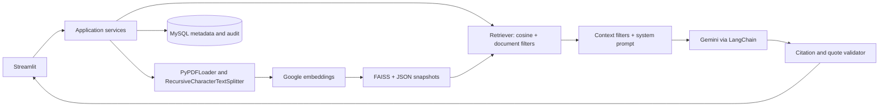

# Intelligent Document AI Pipeline

An evidence-first RAG application for private corporate PDFs, built as a maintainable final-year Computer Science project. Upload a policy, ask a question, and inspect the exact document pages used to answer it.

**Implemented:** PDF ingestion, page-preserving chunking, Google embeddings, persisted FAISS search, Gemini structured answers, verified source references, MySQL audit records, Streamlit dashboard, two authenticated roles, tests, evaluation and synthetic PDFs. This is a single-host academic system with explicit security boundaries, not a certified enterprise data platform.

## Problem and objectives

Policies and project knowledge are often distributed across long PDFs. Keyword search finds words but makes people assemble answers manually. This project retrieves a small set of relevant passages and asks Gemini to answer using only that evidence. It demonstrates semantic retrieval, reliable metadata mapping, abstention, prompt-injection mitigation, and measured pipeline latency.

## Features

- Multi-PDF upload with type, size, filename, encryption, text and duplicate checks.
- Recursive text splitting (1000 characters / 150 overlap), retaining document, page and chunk IDs.
- Normalized FAISS inner-product search, top-k and document filters, cosine threshold.
- Atomic index snapshots with integrity checks, JSON metadata and restart recovery; no pickle.
- Google provider abstractions and an explicitly labeled, offline hash/excerpt demo.
- Structured factual claims with source labels and exact supporting quotes; invalid evidence causes abstention.
- Shared admin/user passwords stored as salted PBKDF2 hashes; admin-only upload, deletion and audit history.
- Overview metrics, chat, bounded question memory, library, source passages and measured timings.
- MySQL schema, SQLAlchemy transactions, SQLite demo/test option, JSON event logging.

## Architecture and technology



Python 3.11+, LangChain Core/Community/Text Splitters/Google GenAI, FAISS CPU, SQLAlchemy 2, MySQL Connector, Pydantic Settings, Streamlit, PyPDF and ReportLab. Direct FAISS is used to avoid pickle-based vector-store persistence. Application services are the internal API; there is no separate public REST server.

## Installation

Open a terminal **in this repository**. On Windows PowerShell:

```powershell
python -m venv .venv
.\.venv\Scripts\Activate.ps1
python -m pip install -r requirements-lock.txt
```

If activation is disabled by your policy, use `.\.venv\Scripts\python.exe` instead of `python`, and `python -m streamlit` instead of `streamlit`. You do not need to weaken your PowerShell execution policy.

Linux/macOS:

```bash
python3 -m venv .venv
source .venv/bin/activate
python -m pip install -r requirements-lock.txt
```

`requirements.txt` specifies compatible direct dependency ranges; `requirements-lock.txt` records the complete environment installed during verification on Windows/Python 3.13.9. Python 3.11 is the source target, but that interpreter has not been exercised here. If a locked wheel is unavailable on another platform, install the ranged requirements and run the test suite before use.

## Quick start: offline demonstration

```powershell
python scripts/setup_env.py --mode demo
python scripts/ingest.py data/sample_documents
python -m streamlit run app.py
```

Setup prompts for **two passwords of at least 12 characters** and writes only their hashes to `.env`. Ingestion asks for the admin password. Open [localhost:8501](http://localhost:8501), choose a role and sign in with its password. There are no default application passwords. You can also upload the supplied PDFs through the administrator UI.

Demo mode uses SQLite and deterministic hashed words, then returns cited **verbatim excerpts**. It makes no Google calls and is not a semantic or generative AI substitute. Demo threshold is 0.12; do not carry that value over to Google embeddings without evaluation.

For a reproducible self-contained test run with synthetic data only:

```powershell
python scripts/smoke_demo.py
```

This creates an isolated, ignored `tmp/smoke-*` directory. Normal user uploads live outside the repository. The smoke runner's temporary password is a test fixture, never an application credential.

## Google Gemini and MySQL setup

For a new `.env`:

```powershell
python scripts/setup_env.py --mode google
```

Setup refuses to overwrite an existing `.env`. To switch an existing demo installation, edit it: set `APP_MODE=google`, `EMBEDDING_PROVIDER=google`, `DB_BACKEND=mysql`, `SIMILARITY_THRESHOLD=0.35`, and use a **different DATA_DIR and database**. Index fingerprints deliberately prohibit mixing embedding models.

Set `GOOGLE_API_KEY` and your `MYSQL_*` values. Keep login hashes generated by setup. Use MySQL 8+; create the database with an administrator account:

```powershell
mysql -u root -p
```

At the MySQL prompt (forward slashes also work on Windows):

```sql
SOURCE database/schema.sql;
CREATE USER 'document_ai'@'localhost' IDENTIFIED BY 'REPLACE_WITH_YOUR_OWN_STRONG_PASSWORD';
GRANT SELECT, INSERT, UPDATE, DELETE ON document_ai.* TO 'document_ai'@'localhost';
```

The password shown is an instruction to substitute your own value, not a shipped credential. `SOURCE` is relative to the directory where you launched `mysql`; use an absolute schema path if needed. Set `AUTO_CREATE_TABLES=false` after applying the schema so the runtime account needs only DML rights. On POSIX shells the equivalent schema command is:

```bash
mysql -u root -p < database/schema.sql
```

Alternatively, create the database and grant a setup account table-creation privileges, then run:

```powershell
python scripts/init_db.py
```

The ORM initializes **tables in an existing database**, not a MySQL server or database. Use the SQL script for initial database creation. For an existing schema, `create_all` does not perform migrations.

```powershell
python scripts/ingest.py data/sample_documents
python -m streamlit run app.py
```

Google mode sends extracted document chunks to Google for embeddings and selected context/questions to Gemini. Obtain organizational authorization before using private data. Model access and charges depend on your Google account.

## Environment configuration

All supported settings are in [.env.example](.env.example) and validated in `config/settings.py`.

| Setting | Purpose / default |
|---|---|
| `APP_MODE` | `google` or `demo` |
| `GOOGLE_API_KEY` | Required for Google mode |
| `EMBEDDING_PROVIDER`, `EMBEDDING_MODEL` | `google`, `models/gemini-embedding-001`; `hash` only in demo |
| `LLM_MODEL`, `LLM_TEMPERATURE` | `gemini-3.8-flash`, `0.2`; configurable |
| `MYSQL_HOST`, `MYSQL_PORT` | `localhost`, `3306` |
| `MYSQL_DATABASE`, `MYSQL_USER`, `MYSQL_PASSWORD` | Database and runtime credentials |
| `DB_BACKEND`, `AUTO_CREATE_TABLES` | `mysql`, `true`; SQLite available for demos/tests |
| `ADMIN_PASSWORD_HASH`, `USER_PASSWORD_HASH` | Required salted login hashes, generated by setup |
| `DATA_DIR` | Blank defaults to `~/.document_ai`; demo setup uses `~/.document_ai_demo` |
| `FAISS_INDEX_PATH`, `UPLOAD_DIR` | `data/vector_store`, `data/uploads`, relative to DATA_DIR |
| `CHUNK_SIZE`, `CHUNK_OVERLAP` | 1000 / 150 characters |
| `TOP_K`, `SIMILARITY_THRESHOLD` | 5 / 0.35 cosine similarity; calibrate for your corpus |
| `MAX_UPLOAD_MB`, `MAX_PDF_PAGES` | 20 MB / 300 pages |
| `MAX_EXTRACTED_CHARS` | 2,000,000 total extracted characters |
| `MAX_QUESTION_CHARS`, `MAX_CONTEXT_CHARS` | 2000 / 12000 characters |
| `MEMORY_TURNS` | At most 3 prior user questions |
| `API_TIMEOUT_SECONDS` | 60 seconds; Google chat has up to two retries |
| `AUDIT_STORE_TEXT` | `true`; false stores `[redacted]` question/answer, keeping metadata |

The current model identifiers were checked against [Google's model catalog](https://ai.google.dev/gemini-api/docs/models) and [embedding documentation](https://ai.google.dev/gemini-api/docs/embeddings). The integration follows [LangChain Google chat](https://docs.langchain.com/oss/python/integrations/chat/google_generative_ai) and [embedding APIs](https://docs.langchain.com/oss/python/integrations/embeddings/google_generative_ai). Low temperature is a configurable project requirement, not proof of truth. LangChain documents a temperature of 1.0 for Gemini 3 models; compare that setting on your evaluation set if 0.2 degrades responses.

## RAG workflow

An authenticated administrator uploads a PDF. The application validates its filename/header/size, calculates SHA-256, writes a UUID-named PDF, extracts text, splits **within each page**, embeds in batches and publishes a FAISS/JSON snapshot. Only then does its SQL status become `ready`.

An authenticated question is validated, optionally expanded with one bounded prior question, embedded and searched. SQL-ready document IDs and optional selected IDs filter candidates before final top-k. Low-score and suspicious passages are removed. Gemini sees a separate system message and JSON-encoded untrusted evidence. The answer validator requires known source labels and exact matching quotes. An unsupported answer or empty retrieval produces an explicit no-answer response. Query evidence and timing are committed before returning the answer.

## Project structure

```text
app.py                   Streamlit entry point
config/                  Pydantic environment settings
database/                MySQL schema, ORM, repository transactions
ingestion/               PDF extraction, cleaning, page-aware chunking
embeddings/              Provider protocol, Google and offline baseline
vector_store/            FAISS snapshots and metadata mapping
retrieval/               Query embedding and filtered retrieval
llm/                     Gemini, system prompt, evidence validation
services/                Ingestion/query/audit/statistics orchestration
security/                Role authentication and password hashing
ui/                      Dashboard, upload, chat, library and audit
utils/                   Validation, errors, hashing, safe event logs
scripts/                 Setup, ingest, evaluate, samples and smoke CLI
tests/                   Offline unit/integration/UI tests
data/sample_documents/   Three synthetic two-page PDFs
evaluation/              Labeled questions and metric runner
docs/                    Architecture, security, report and diagrams
```

## Security and guardrails

The app binds to loopback by default. Both roles query the same corpus; metadata filters are search controls, **not per-document authorization**. Only admin manages documents or sees global history. Login uses PBKDF2-HMAC-SHA256 (600,000 iterations), constant-time comparison and a process-local role lockout after failed attempts. Session data clears on sign-out.

No credentials or document contents enter application event logs. `.env`, runtime indexes, uploads and databases are ignored by Git. Query text is sensitive and can be disabled in audit storage. Local OS account access remains a trust boundary: files and index metadata are not encrypted, and checksums do not authenticate an attacker-modified snapshot. Protect DATA_DIR with OS permissions and backups.

Prompt boundaries, heuristic passage quarantine, similarity filtering and quote validation **mitigate** injection and hallucination. A quote can be real yet fail to logically support a model's statement. This implementation does not guarantee semantic entailment or complete injection prevention. See [security.md](docs/security.md).

## Testing and evaluation

```powershell
python -m pytest -q
python -m ruff check .
python -m pip check
python scripts/smoke_demo.py
python scripts/evaluate.py --output evaluation/results.json
```

Normal tests use synthetic PDFs, SQLite, actual FAISS and offline/mocked providers. They require no paid API requests. One MySQL schema test is opt-in via `TEST_MYSQL_DATABASE`; use a dedicated test schema and configured MySQL credentials. See [verification.md](docs/verification.md) for actual checks and explicit omissions, and [evaluation/README.md](evaluation/README.md) for metric definitions. Evaluation adds records to the audit database and calls Google in Google mode.

## 2–5 minute demonstration

1. Sign in as admin, show the empty dashboard and upload the three samples together.
2. Explain pages, chunks and measured embedding/indexing times. Re-upload one file to show duplicate detection.
3. Ask “What is the annual leave entitlement?” Open the source passage and page 1 citation.
4. Ask “What are the password requirements?” Then ask an unrelated question to demonstrate abstention.
5. Show document filtering, admin query history and dashboard metrics. Restart and show that indexing persists.
6. Explain the difference between the offline demonstration and Gemini generation. Use Google mode for synthesis and semantic-search claims.

## Limitations and future work

No OCR, robust table extraction, document ACLs, SSO, encryption-at-rest, malware sandbox, distributed worker queue, automatic retention or database migrations. Ingestion and queries serialize on a local file lock; a slow API request delays others. FAISS IndexFlatIP is exact O(Nd) search and loads the corpus into memory; snapshot publication copies the index. It is suitable for modest student corpora, not millions of documents. Follow-up resolution is a bounded heuristic. Provider availability and real Google quality require configured credentials and live evaluation.

Add OCR, hybrid search/reranking, an entailment evaluator, account identities, document ACLs, encrypted backups, retention jobs, schema migrations and a job queue before expanding deployment. More detailed viva and report material is in [docs/project_report.md](docs/project_report.md).
